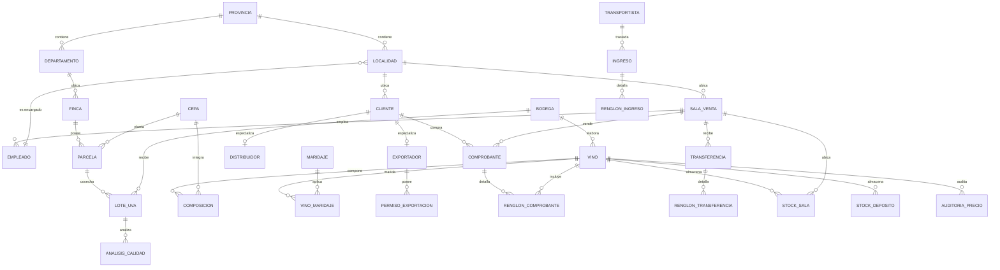

# Informe final: Bodegas del Atuel

Trabajo Práctico Integrador de Bases de Datos — UTN Facultad Regional San
Rafael.

## 1. Introducción y alcance

Bodegas del Atuel modela una bodega vitivinícola integrada: producción de uva,
elaboración de vino, stock por sala y depósito, clientes con distintos tipos,
ventas, ingresos, transferencias y reportes. El objetivo del trabajo no fue
construir una aplicación comercial completa, sino demostrar que **la base de
datos puede ser el centro del sistema**: que las reglas de negocio vivan en
constraints, funciones, procedimientos y triggers, y que la API y el front las
consuman sin reimplementarlas.

### 1.1. Alcance entregado

| Componente | Estado |
|---|---|
| Modelo relacional normalizado hasta 3FN | 30 tablas, 3 vistas, 2 tipos enumerados y 1 dominio. |
| Migraciones reproducibles | `db/migrations/001_esquema.sql` a `008_indices.sql`. |
| Reglas de negocio en la base | 19 `CHECK`, 4 `UNIQUE`, 37 FKs, 8 funciones, 3 procedimientos y 17 triggers. |
| Volumen de datos | 150.021 comprobantes, 500.022 renglones, 20.000 clientes, 1.007 vinos. |
| Consultas del enunciado | U1–U6, I1–I6, D1–D6 y S1–S12 resueltas y probadas. |
| API REST | 22 paths y 30 operaciones; 81 pruebas automáticas. |
| Front | Cinco pantallas contra la API real. |
| Despliegue | Supabase + Render + Cloudflare Workers, con HTTPS, CORS, backup y restauración. |
| Documentación | README, este informe, trazabilidad RN, concurrencia, rendimiento y Etapa 8. |

### 1.2. Fuera de alcance

- Autenticación y autorización de usuarios finales. La API se protege a nivel de
  rol de base de datos, no con login HTTP.
- Diseño visual sofisticado. El front prioriza mostrar el dato y los errores de
  la base.
- Alta disponibilidad, monitoreo y backups automáticos. El despliegue usa planes
  gratuitos con las limitaciones documentadas en la Etapa 8.

### 1.3. URLs públicas

| Componente | URL |
|---|---|
| Front | <https://bodega-del-atuel-front.franco11carballo.workers.dev/> |
| API | <https://bodega-del-atuel-back.onrender.com/> |
| Salud | <https://bodega-del-atuel-back.onrender.com/salud> |
| Swagger | <https://bodega-del-atuel-back.onrender.com/docs> |

### 1.4. Stack

- PostgreSQL 17 (local en Docker y en Supabase).
- Python 3.14/3.15 + FastAPI + `psycopg` 3, sin ORM.
- React + Vite + TypeScript para el front.
- Docker Compose para el entorno local; nginx para servir el front y proxyar
  `/api`.
- Cloudflare Workers para el front y Render para la API en la nube.

## 2. Modelo de datos

### 2.1. Diagrama entidad-relación

El modelo se organiza en seis bloques: geografía, producción, productos,
clientes, movimientos y stock/auditoría. Las relaciones principales son:



### 2.2. Esquema relacional

| Bloque | Tablas | Clave primaria |
|---|---|---|
| Geografía | `provincia`, `departamento`, `localidad` | `id_provincia`, `id_departamento`, `cp` |
| Salas y personal | `sala_venta`, `empleado` | `id_sala`, `cuit` |
| Transporte | `transportista`, `transportista_cubre_localidad` | `cod_transportista`; PK compuesta |
| Producción | `finca`, `parcela`, `lote_uva`, `analisis_calidad` | `id_finca`; `(id_finca, nro_parcela)`; `nro_lote`; `id_analisis` |
| Productos | `cepa`, `bodega`, `vino`, `maridaje`, `composicion`, `vino_maridaje` | `id_cepa`, `cuit_bodega`, `cod_vino`, `id_maridaje`; PK compuestas |
| Clientes | `cliente`, `distribuidor`, `exportador`, `permiso_exportacion` | `id_cliente`; subtipos con la misma PK |
| Ventas | `comprobante`, `renglon_comprobante` | `nro_comprobante`; `(nro_comprobante, cod_vino)` |
| Ingresos | `ingreso`, `renglon_ingreso` | `cod_ingreso`; `(cod_ingreso, cod_vino)` |
| Transferencias | `transferencia`, `renglon_transferencia` | `nro_transferencia`; `(nro_transferencia, cod_vino)` |
| Stock y auditoría | `stock_sala`, `stock_deposito`, `auditoria_precio` | `(id_sala, cod_vino)`, `cod_vino`, `id_auditoria` |

Las 37 claves foráneas usan `ON DELETE RESTRICT` salvo las relaciones de
detalle (`renglon_*`), la composición, los maridajes y los subtipos de cliente,
que usan `ON DELETE CASCADE`. Esa diferencia es deliberada: un documento puede
borrarse con su detalle, pero una bodega, un vino o un transportista con
movimientos no puede desaparecer.

### 2.3. Normalización

El esquema está en **tercera forma normal**:

- **1FN:** todos los atributos son atómicos. No hay listas de cepas ni de
  maridajes dentro de `vino`; se resuelven con `composicion` y
  `vino_maridaje`. Tampoco se repiten teléfonos o direcciones en columnas
  múltiples.
- **2FN:** en las tablas con clave compuesta, cada atributo depende de toda la
  clave. En `renglon_comprobante`, `cantidad`, `precio_unitario`, `descuento` y
  `subtotal` dependen de `(nro_comprobante, cod_vino)`, no solo del comprobante.
  En `composicion`, `porcentaje` depende de `(cod_vino, id_cepa)`.
- **3FN:** no hay dependencias transitivas. `localidad` guarda `id_provincia`,
  no el nombre de la provincia; `vino` guarda `cuit_bodega`, no la razón social
  de la bodega; `comprobante` no guarda el nombre ni el tipo del cliente.

La única redundancia intencional es `comprobante.subtotal`, `descuento` y
`total`, que se derivan de los renglones. Se mantienen por rendimiento y por
requisito del enunciado, y los triggers los recalculan en cada cambio para que
nunca queden desactualizados. Es una **desnormalización controlada**, no una
violación de 3FN: los valores no se cargan a mano.

### 2.4. Diccionario de datos

| Tabla | Propósito | Columnas relevantes |
|---|---|---|
| `provincia` | Catálogo geográfico de primer nivel. | `id_provincia`, `nombre` |
| `departamento` | División de una provincia. | `id_departamento`, `id_provincia`, `nombre` |
| `localidad` | Ciudad o localidad con encargado regional. | `cp`, `nombre`, `id_provincia`, `cuit_encargado_regional` |
| `sala_venta` | Punto de venta con día de cierre. | `id_sala`, `cp_localidad`, `calle`, `numero`, `dia_cierre`, `activo` |
| `empleado` | Personal asignado a una sala. | `cuit`, `id_sala`, `nombre`, `fecha_ingreso`, `salario`, `activo` |
| `transportista` | Empresa que traslada ingresos. | `cod_transportista`, `razon_social`, `cuit`, `email`, `telefono`, `domicilio` |
| `transportista_cubre_localidad` | Cobertura N:M entre transportista y localidad. | `cod_transportista`, `cp_localidad` |
| `cepa` | Variedad de uva. | `id_cepa`, `nombre`, `tipo` |
| `finca` | Explotación agrícola. | `id_finca`, `id_departamento`, `nombre`, `superficie` |
| `parcela` | Entidad débil de finca, con cepa y año de plantación. | `id_finca`, `nro_parcela`, `id_cepa`, `superficie`, `anio_plantacion` |
| `bodega` | Elaborador de vinos. | `cuit_bodega`, `razon_social`, `domicilio` |
| `lote_uva` | Cosecha de una parcela en una campaña. | `nro_lote`, `id_finca`, `nro_parcela`, `cuit_bodega`, `campania`, `fecha`, `kg` |
| `analisis_calidad` | Análisis de un lote de uva. | `id_analisis`, `nro_lote`, `fecha`, `brix`, `ph`, `acidez` |
| `vino` | Producto elaborado. | `cod_vino`, `cuit_bodega`, `nombre`, `tipo`, `aniada`, `volumen`, `graduacion`, `precio`, `activo` |
| `maridaje` | Combinación gastronómica. | `id_maridaje`, `nombre`, `temp_servicio` |
| `composicion` | Porcentaje de cada cepa en un vino. | `cod_vino`, `id_cepa`, `porcentaje` |
| `vino_maridaje` | Asociación N:M vino–maridaje. | `cod_vino`, `id_maridaje` |
| `cliente` | Persona o empresa que compra. | `id_cliente`, `cp_localidad`, `nombre_razon_social`, `tipo_doc`, `nro_doc`, `descuento`, `tipo_cliente`, `activo` |
| `distribuidor` | Subtipo con zona y habilitación. | `id_cliente`, `zona_cobertura`, `nro_habilitacion` |
| `exportador` | Subtipo con país de destino. | `id_cliente`, `pais_destino` |
| `permiso_exportacion` | Permisos con vigencia. | `cod_permiso`, `id_cliente`, `fecha_emision`, `fecha_vencimiento` |
| `comprobante` | Cabecera de venta. | `nro_comprobante`, `id_cliente`, `id_sala`, `fecha`, `subtotal`, `descuento`, `total` |
| `renglon_comprobante` | Detalle de venta por vino. | `nro_comprobante`, `cod_vino`, `cantidad`, `precio_unitario`, `descuento`, `subtotal` |
| `ingreso` | Documento de ingreso de mercadería. | `cod_ingreso`, `cod_transportista`, `cuit_bodega`, `fecha`, `estado` |
| `renglon_ingreso` | Detalle del ingreso. | `cod_ingreso`, `cod_vino`, `cantidad` |
| `transferencia` | Pedido de stock de una sala al depósito. | `nro_transferencia`, `id_sala`, `fecha_confeccion`, `estado` |
| `renglon_transferencia` | Detalle de la transferencia. | `nro_transferencia`, `cod_vino`, `cantidad` |
| `stock_sala` | Stock materializado por sala y vino. | `id_sala`, `cod_vino`, `cantidad` |
| `stock_deposito` | Stock materializado del depósito central. | `cod_vino`, `cantidad` |
| `auditoria_precio` | Historial de cambios de precio. | `id_auditoria`, `cod_vino`, `precio_anterior`, `precio_nuevo`, `fecha_hora`, `usuario` |

Vistas:

| Vista | Contenido |
|---|---|
| `stock_total_vino` | Stock por vino sumando depósito y todas las salas. |
| `ventas_mensuales_sala` | Ventas, botellas y monto por sala y mes. |
| `documentos_pendientes` | Ingresos y transferencias que no están procesados. |

### 2.5. Decisiones de diseño

1. **Claves sustitutas en entidades fuertes.** `vino`, `cliente`,
   `comprobante`, `ingreso` y `transferencia` usan `SERIAL`. Son identificadores
   estables que no cambian aunque cambie el nombre o el documento.
2. **Claves naturales en catálogos.** `provincia`, `departamento`, `localidad`
   y `bodega` usan el código o CUIT porque ya son identificadores del dominio.
3. **Entidad débil `parcela`.** Su PK es `(id_finca, nro_parcela)`: una parcela
   no existe sin finca y su número solo es único dentro de ella.
4. **Herencia disjunta de clientes.** `cliente` guarda lo común y
   `distribuidor` / `exportador` lo específico. La PK de los subtipos es la
   misma FK a `cliente`, lo que garantiza la relación 1:1. Los triggers
   impiden que un cliente tenga el subtipo equivocado o ambos a la vez.
5. **N:M con atributos.** `composicion` no es una simple tabla de unión: lleva
   `porcentaje`, y un trigger diferido verifica que la suma sea 100.
6. **Dominio `cuit_dom`.** Unifica el formato de todos los CUIT y agrega un
   `CHECK` de 11 dígitos. Evita repetir la validación en cada tabla.
7. **Tipos enumerados.** `estado_enum` y `dia_semana_enum` restringen los
   valores posibles sin tablas auxiliares.
8. **Baja lógica (soft delete).** `vino`, `cliente`, `sala_venta`, `empleado`,
   `finca`, `parcela`, `bodega` y `transportista` tienen la columna `activo`.
   La API da de baja vinos y clientes con `UPDATE ... SET activo = FALSE`, nunca
   con `DELETE`. Esto conserva el historial de ventas, auditoría y relaciones.
   Los listados filtran por `activo = TRUE` y el detalle de un recurso inactivo
   devuelve `404`. No hay endpoint de reactivación; la única vía es actualizar
   directamente en la base. La regla RN-14 (`ON DELETE RESTRICT`) sigue vigente
   para borrados físicos directos, que la API nunca ejecuta.
9. **FK diferida `localidad` → `empleado`.** El encargado regional se referencia
   con `DEFERRABLE INITIALLY DEFERRED` para permitir cargar localidades y
   empleados en el mismo proceso sin un orden rígido.
10. **Stock materializado.** `stock_sala` y `stock_deposito` guardan cantidades
    actuales para evitar sumar todos los movimientos en cada venta. Los
    triggers y procedimientos los mantienen consistentes.

11. **Acciones referenciales (`ON DELETE` / `ON UPDATE`).** Se eligió
    `ON DELETE RESTRICT` para todas las FK que apuntan a entidades maestras
    (bodega, vino, transportista, sala, cliente, finca, cepa, localidad,
    empleado). Motivo: conservar el historial de ventas y movimientos; borrar
    una entidad con movimientos asociados rompería la trazabilidad. Se eligió
    `ON DELETE CASCADE` para las tablas de detalle (`renglon_*`), composición,
    maridajes y subtipos de cliente, porque no tienen sentido sin su padre.
    `ON UPDATE CASCADE` se aplicó en `sala_venta.cp_localidad`,
    `localidad.cuit_encargado_regional`, `lote_uva.cuit_bodega`,
    `vino.cuit_bodega`, `ingreso.cuit_bodega`, `comprobante.id_sala` e
    `empleado.id_sala` para que un cambio de código natural (CUIT, sala,
    localidad) se propague automáticamente a las filas dependientes sin perder
    integridad. El resto de las FK usa `ON UPDATE NO ACTION` (default), porque
    las claves sustitutas (`SERIAL`) no cambian y las claves naturales que
    podrían cambiar (CUIT) ya tienen CASCADE donde corresponde.

## 3. Integridad y lógica en la base

### 3.1. Tabla de trazabilidad regla → mecanismo → prueba

La tabla completa está en [`docs/TRAZABILIDAD_RN.md`](TRAZABILIDAD_RN.md). El
resumen es:

| RN | Regla | Mecanismo | Prueba | Estado |
|---|---|---|---|---|
| RN-01 | Precio de vino único y mayor que cero. | `UNIQUE (nombre, aniada, volumen)` + `CHECK (precio > 0)` | `RN-01` | PASSED |
| RN-02 | Sala en una localidad con encargado existente. | FKs `sala_venta.cp_localidad` y `localidad.cuit_encargado_regional` | `RN-02` | PASSED |
| RN-03 | Cada empleado trabaja en una sola sala. | `empleado.id_sala NOT NULL` + FK | `RN-03` | PASSED |
| RN-04 | Una parcela se cosecha una vez por campaña. | `UNIQUE (id_finca, nro_parcela, campania)` | `RN-04` | PASSED |
| RN-05 | La composición suma 100 %. | Constraint triggers diferidos | `RN-05` | PASSED |
| RN-06 | Descuento por tipo de cliente. | `CHECK chk_cliente_descuento` | `RN-06` | PASSED |
| RN-07 | Vencimiento del permiso posterior a la emisión. | `CHECK chk_permiso_fechas` | `RN-07` | PASSED |
| RN-08 | El total se deriva de los renglones. | Triggers de subtotal, importes y `fn_importes_comprobante` | `RN-08` | PASSED |
| RN-09 | No vender más que el stock de la sala. | `trg_renglon_validar_stock` + `trg_renglon_actualizar_venta` | `RN-09` | PASSED |
| RN-10 | Solo un ingreso terminado pasa a procesado. | `trg_ingreso_estados` + `sp_procesar_ingreso` | `RN-10` | PASSED |
| RN-11 | Transiciones válidas de transferencia y fecha inmodificable. | `trg_transferencia_estados` + `trg_transferencia_fecha` | `RN-11` | PASSED |
| RN-12 | Documentos fuera de confección no admiten cambios. | Triggers de bloqueo de renglones | `RN-12` | PASSED |
| RN-13 | Auditoría de cambios de precio. | `trg_vino_auditoria` | `RN-13` | PASSED |
| RN-14 | No borrar entidades con movimientos. | FKs `ON DELETE RESTRICT` | `RN-14` | PASSED |
| RN-15 | Graduación entre 5 y 20 grados. | `CHECK chk_vino_graduacion` | `RN-15` | PASSED |

Las 21 pruebas se ejecutan con `./tests/run_db_tests.sh` y terminan con
`PASSED`.

### 3.2. Guía: dónde va cada regla

| Tipo de regla | Mecanismo | Ejemplo |
|---|---|---|
| Valor puntual o rango | `CHECK` | Precio > 0, graduación 5–20, stock ≥ 0. |
| Unicidad | `UNIQUE` | Documento de cliente, identidad de vino, cosecha por campaña. |
| Existencia de una referencia | FK | Sala → localidad, renglón → comprobante. |
| Cálculo derivado | Trigger `BEFORE`/`AFTER` | Subtotal de renglón, total de comprobante. |
| Validación que depende de varias filas | Constraint trigger diferido | Composición que suma 100. |
| Transición de estado | Trigger + procedimiento | Ingreso y transferencia. |
| Operación de varios pasos | Procedimiento almacenado | Procesar ingreso o transferencia. |
| Historial | Trigger de auditoría | Cambio de precio. |
| Protección del historial | `ON DELETE RESTRICT` | Bodega con vinos o movimientos. |

El criterio general fue: **si PostgreSQL puede expresarlo como constraint, va
como constraint**; si necesita varias filas o una transición, va como trigger o
procedimiento; si es un cálculo repetitivo, va como función.

### 3.3. Demostración de concurrencia

Se ejecutaron dos sesiones simultáneas sobre la última botella de la sala 1,
vino 1. La salida real está en [`docs/CONCURRENCIA.md`](CONCURRENCIA.md):

```text
== Con FOR UPDATE (implementación real) ==
sesion_A: COMMIT | comprobante=150038
sesion_B: ROLLBACK | SQLSTATE=P0001 | Stock insuficiente en la sala 1 para el vino 1. Disponible: 0, Solicitado: 1
stock_final=0 comprobantes_confirmados=1

== Sin FOR UPDATE (variante de comparación) ==
sesion_A: COMMIT | comprobante=150040
sesion_B: ROLLBACK | SQLSTATE=23514 | ... violates check constraint "chk_stock_sala_positivo"
stock_final=0 comprobantes_confirmados=1
```

Con `FOR UPDATE` la segunda sesión espera, ve el stock actualizado y recibe un
error de negocio claro. Sin bloqueo, el `CHECK` igual impide el oversell, pero
el mensaje es menos útil. La base nunca vende dos veces la misma botella.

### 3.4. Recuento de objetos

| Objeto | Cantidad |
|---|---:|
| Tablas | 30 |
| Vistas | 3 |
| Claves primarias | 30 |
| Claves foráneas | 37 |
| `UNIQUE` | 4 |
| `CHECK` | 19 (18 de tabla + 1 de dominio) |
| Funciones | 8 |
| Procedimientos | 3 |
| Triggers | 17 |
| Índices adicionales | 7 |
| Rutinas en `pg_proc` | 26 |

## 4. Carga masiva

### 4.1. Catálogos y orden de carga

Los catálogos pequeños viven en `db/seed/csv/`: provincias, departamentos,
localidades, cepas, tipos de vino, presentaciones, maridajes y campañas. El
script `db/seed/seed.py` los lee y genera el resto con `Faker` y una semilla
fija (`SEED = 12345`), de modo que dos ejecuciones producen los mismos datos.

Orden de carga:

1. Geografía: provincias, departamentos y localidades.
2. Catálogos: cepas, salas, transportistas, bodegas, maridajes.
3. Producción: fincas, parcelas, lotes de uva y análisis.
4. Productos: vinos, composición y maridaje.
5. Clientes: clientes, distribuidores, exportadores y permisos.
6. Movimientos: ingresos, transferencias y comprobantes con sus renglones.
7. Stock inicial y auditoría.

El script usa `execute_values` en lotes de hasta 1.000 filas para las tablas
grandes.

### 4.2. Estrategia frente a los triggers

La carga reproducible con `seed.py` se ejecuta **con los triggers activos**. No
usa `ALTER TABLE ... DISABLE TRIGGER`. Así, si un dato generado viola una regla,
la transacción falla y se corrige el generador en lugar de cargar datos
inválidos.

La excepción es la restauración del dump (`db/seed/dump_datos.sql.gz`), que
representa datos ya validados. Ese archivo usa
`session_replication_role = replica` para restaurar sin depender del orden de
las claves foráneas y sin recalcular triggers. No es una carga de producción: es
una restauración de un estado consistente.

### 4.3. Tiempos y comparación

| Método | 2.000 registros |
|---|---:|
| Fila por fila con `cursor.execute` | 0,3166 s |
| Lote con `execute_values` | 0,1125 s |

La carga por lotes fue aproximadamente **2,8 veces más rápida**. El tiempo total
de la carga completa con triggers activos fue de aproximadamente **101,59 s**.

### 4.4. Volumen y controles

| Tabla | Filas |
|---|---:|
| `comprobante` | 150.021 |
| `renglon_comprobante` | 500.022 |
| `cliente` | 20.000 |
| `vino` | 1.007 |
| `ingreso` | 1.000 |
| `transferencia` | 1.009 |
| `lote_uva` | 600 |
| `analisis_calidad` | 1.200 |

El requisito de más de 100.000 filas se cumple en `comprobante` y en
`renglon_comprobante`.

Consultas de control ejecutadas al finalizar:

- Conteo de todas las tablas públicas, sin tablas vacías.
- Stock negativo en `stock_sala` y `stock_deposito`.
- Renglones huérfanos de comprobantes, ingresos y transferencias.
- Composiciones cuya suma no sea 100.
- Comprobantes cuyo total no coincida con la suma de sus renglones.

En la ejecución verificada, todos los controles devolvieron cero
inconsistencias.

## 5. Índices y rendimiento

### 5.1. Índices creados

`db/migrations/008_indices.sql` crea siete índices:

| Índice | Tipo | Uso |
|---|---|---|
| `idx_comprobante_fecha_sala` | Compuesto | Filtrar por fecha y agrupar por sala. |
| `idx_renglon_transferencia_vino` | FK | Filtrar renglones por vino en S4. |
| `idx_transferencia_pendientes_fecha_sala` | Parcial | Transferencias no procesadas. |
| `idx_comprobante_fecha_include_total` | `INCLUDE` | S8 con `Index Only Scan`. |
| `idx_comprobante_sala_fecha` | Compuesto + `INCLUDE` | S3 y S11. |
| `idx_renglon_comprobante_vino` | FK + `INCLUDE` | S1/S12 filtradas por vino. |
| `idx_vino_nombre_lower` | Expresión | Búsquedas `lower(nombre)`. |

Se cumplen los tipos pedidos: compuesto, parcial, sobre FK y de expresión /
`INCLUDE`.

### 5.2. Comparativa antes y después

Medición con `ANALYZE` y `EXPLAIN (ANALYZE, BUFFERS)` sobre el dataset completo:

| Consulta | Antes | Después | Mejora |
|---|---|---:|---:|
| S3: clientes por tipo en una sala | `Parallel Seq Scan` — 20,029 ms | `Index Only Scan` — 8,621 ms | 56,9 % |
| S4: salas que solicitaron un vino | `Seq Scan` — 0,557 ms | `Bitmap Index Scan` — 0,346 ms | 37,9 % |
| S8: ventas por sala del trimestre | `Parallel Seq Scan` — 18,878 ms | `Index Only Scan` — 10,535 ms | 44,2 % |

Los planes completos están en
[`docs/RENDIMIENTO_INDICES.md`](RENDIMIENTO_INDICES.md).

### 5.3. Costo de escritura

Se copió `renglon_comprobante` (500.000 filas) a una tabla temporal, con y sin
el índice por `cod_vino`:

| Configuración | Tiempo |
|---|---:|
| Solo PK | 415,757 ms |
| PK + índice por `cod_vino` | 1.010,135 ms |

El índice adicional incrementó la escritura aproximadamente **143 %**. Se
conserva porque las consultas selectivas por vino mejoran y porque el enunciado
exige medir explícitamente el costo.

### 5.4. Índice descartado y caso sin índice

- **Descartado:** `idx_comprobante_sala` (solo `id_sala`). S8 filtra por fecha,
  no por una sala concreta; el índice simple no evita el recorrido temporal.
- **No usado por el planificador:** en S1, que necesita agrupar los 500.000
  renglones para el ranking completo, PostgreSQL mantiene un `Parallel Seq
  Scan`. Leer toda la tabla es más barato que miles de búsquedas indexadas. El
  índice por vino sí se usa cuando la consulta filtra un vino específico (S4).

## 6. Consultas SQL

### 6.1. Archivos

| Archivo | Consignas | Contenido |
|---|---|---|
| `consultas/update.sql` | U1–U6 | Recalculos, aumentos, intercambio de días y descuentos. |
| `consultas/insert.sql` | I1–I6 | Coberturas, maridajes, comprobantes, bodegas, salas e ingresos. |
| `consultas/delete.sql` | D1–D6 | Borrados con `NOT EXISTS`, `CASCADE` y protección de triggers. |
| `consultas/select.sql` | S1–S12 | Rankings, divisiones, CTE, funciones de ventana y anti-joins. |

Cada archivo tiene encabezados con el código, el enunciado y la estrategia. Las
sentencias que modifican datos se prueban con `BEGIN` / control / sentencia /
`ROLLBACK`; las que no tienen candidatos en el dataset se documentan como tales.

### 6.2. Consultas más interesantes

- **S2 — división relacional:** vinos vendidos en todas las salas. Se resuelve
  contando salas distintas y comparando con el total de salas activas.
- **S10 — CTE y subconsulta correlacionada:** rendimiento kg/ha por parcela y
  campaña, comparado contra el promedio de su finca.
- **S11 — funciones de ventana:** `RANK() OVER (PARTITION BY id_sala ...)` y
  suma acumulada mensual por sala.
- **S12 — `NOT EXISTS`:** clientes que compraron todos los vinos de una bodega,
  con anti-join para detectar los que no.
- **U6 — excepción de descuento:** sube al 35 % a los exportadores con más de
  tres permisos. El `CHECK` de RN-06 admite 30 % base y 35 % para esta
  excepción.
- **D5 — borrado histórico:** usa `set_config('bda.eliminar_ingreso_procesado',
  'on', true)` dentro de la transacción para habilitar únicamente el borrado de
  ingresos procesados antiguos. El trigger sigue bloqueando cualquier otro
  borrado.
- **I3 — venta transaccional:** crea cabecera y tres renglones usando
  `fn_descuento_cliente` y `fn_calcular_subtotal`; los triggers calculan
  importes y stock. La prueba produjo 3.642,00 de subtotal, 364,20 de descuento
  y 3.277,80 de total.

### 6.3. Resultados de las pruebas

| Caso | Resultado |
|---|---|
| U1 | 150.000 comprobantes recalculados. |
| U2 | 11 empleados con más de 5 años, salario × 1,20. |
| U3 | 50 vinos de una bodega con +13 %. |
| U4 | 0 filas: la carga solo tenía salas con cierre domingo. |
| U5 | 10 vinos menos vendidos con −15 %. |
| U6 | Exportadores con más de 3 permisos al 35 %. |
| I1 | 0 inserciones: la cobertura ya existía; se verificó `ON CONFLICT`. |
| I2 | Maridaje y 80 asociaciones verificadas sin duplicados. |
| I3 | Comprobante temporal con 3 renglones y totales calculados. |
| I4 | Bodega `30999999999` creada y revertida. |
| I5 | Sala 19 en General Alvear creada y revertida. |
| I6 | Ingreso en confección de 120 botellas creado y revertido. |
| D1–D6 | Sin candidatos en la carga; sentencias ejecutadas sin error y rutas probadas dentro de la transacción. |

El detalle está en [`docs/ETAPA5_CONSULTAS.md`](ETAPA5_CONSULTAS.md).

## 7. API y front

### 7.1. Arquitectura de la API

```text
HTTP → router (Pydantic) → pool psycopg → DAO (SQL parametrizado)
     → PostgreSQL (constraints, funciones, triggers)
     → JSON
```

La API no contiene SQL en los routers ni cálculos de negocio en Python. Cada
recurso tiene su DAO; cada operación de escritura usa una transacción explícita.
Al crear un comprobante, la API inserta importes en cero y deja que PostgreSQL
los complete con sus triggers.

### 7.2. Endpoints

22 paths y 30 operaciones:

| Recurso | Rutas |
|---|---|
| Salud | `GET /salud`, `GET /health` |
| Catálogos | `GET /catalogos` |
| Vinos | `GET/POST /vinos`, `GET/PUT/DELETE /vinos/{cod}` |
| Clientes | `GET/POST /clientes`, `GET/PUT/DELETE /clientes/{id}` |
| Comprobantes | `POST /comprobantes`, `GET /comprobantes/{nro}` |
| Transferencias | `POST /transferencias`, `POST /{cod}/renglones`, `/terminar`, `/procesar` |
| Ingresos | `POST /ingresos`, `POST /{cod}/renglones`, `/terminar`, `/procesar` |
| Reportes | `top-vinos`, `ventas-por-sala`, `vinos-sin-stock`, `transportista-activo`, `trazabilidad/{cod}` |

OpenAPI está disponible en `/docs`, `/redoc` y `/openapi.json`.

### 7.3. Traducción de errores

| SQLSTATE | Situación | HTTP |
|---|---|---:|
| `23502` | `NOT NULL` violado | 422 |
| `23503` | FK violada | 409 |
| `23505` | Unique/PK duplicada | 409 |
| `23514` | `CHECK` violado | 422 |
| `22P02` | Texto inválido para un tipo | 400 |
| `P0001` | Regla de negocio (`RAISE EXCEPTION`) | 409 |
| `40001` / `40P01` | Serialización / deadlock | 503 |

Los errores `503` incluyen `"reintentar": true`. Los errores `500` no exponen
credenciales ni la cadena de conexión.

### 7.4. Pruebas

```text
81 passed (55 unitarias + 26 de integración)
Ruff: All checks passed!
```

Las pruebas de integración usan PostgreSQL real y revierten todo al finalizar.
Cubren, entre otras cosas:

- Composición que no suma 100 % → `23514` → 422.
- Descuento de cliente fuera de rango → `23514` → 422.
- Documento de cliente duplicado → `23505` → 409.
- Vino duplicado por identidad → `23505` → 409.
- Venta sin stock → rollback completo.
- Transferencia procesada sin estado terminado → `P0001` → 409.

Durante la validación se encontraron y corrigieron dos bugs reales en ambos
repositorios:

1. `list_tipos_vino` usaba `row[0]` con `dict_row`, lo que rompía
   `/catalogos`. Se cambió a `row["tipo"]`.
2. `update_cliente` actualizaba `tipo_cliente` antes de borrar el subtipo
   anterior, lo que violaba la herencia disjunta. Ahora borra el subtipo primero
   y luego actualiza el tipo, dentro de la misma transacción.

### 7.5. Inyección SQL fallida

```bash
curl --get "https://bodega-del-atuel-back.onrender.com/vinos" \
  --data-urlencode "tipo=tinto' OR 1=1 --" \
  --data-urlencode "por_pagina=10"
# {"items":[],"pagina":1,"por_pagina":10,"cantidad":0}
```

El valor se trata como texto y no devuelve filas fuera del filtro. Además, una
prueba recorre los archivos del DAO y falla si aparece `execute(f"`,
`execute(f'`, `execute(query %` o `execute(query +`.

### 7.6. Front

| Pantalla | Qué muestra |
|---|---|
| Catálogo | Listado paginado con filtros por tipo, cepa, bodega y añada; detalle con composición y maridajes. |
| Alta / Edición | Formulario con composición de cepas; muestra el error cuando los porcentajes no suman 100. |
| Nueva venta | Cliente, sala, vinos y total calculado por el backend; muestra el error de stock insuficiente. |
| Transferencias | Crear, cargar renglones y avanzar de estado con botones habilitados según el estado. |
| Tablero | Top 10 de vinos, ventas por sala del trimestre y vinos sin stock en una sala. |

El front no calcula totales, descuentos ni stock: solo formatea lo que devuelve
la API y muestra los mensajes de error tal como llegan. La URL base se configura
con `VITE_API_URL` en Cloudflare y con el proxy `/api` de nginx en local.

### 7.7. Docker Compose

Un solo comando levanta los tres servicios:

```bash
docker compose up --build
```

| Servicio | Imagen | Puerto |
|---|---|---:|
| `db` | PostgreSQL 17 | 5433 |
| `api` | FastAPI + Uvicorn | 8000 |
| `front` | nginx + build de Vite | 8080 |

La base aplica las migraciones `001`–`008` en orden y luego carga
`db/seed/dump_datos.sql.gz`. El healthcheck espera a que los datos estén
disponibles antes de arrancar la API.

## 8. Despliegue en la nube

### 8.1. Proveedores elegidos

| Componente | Elegido | Alternativa evaluada | Motivo |
|---|---|---|---|
| Base | Supabase Free | Neon Free | Ya tenía el modelo y el dump en PostgreSQL 17; 107 MB entran en 500 MB. |
| API | Render Free | Railway Free | 750 h/mes sin vencer a los 30 días; Railway da USD 1/mes tras el trial. |
| Front | Cloudflare Workers | Render Static | Sin cold start, 100.000 req/día y assets estáticos suficientes. |

Los límites verificados están en [`docs/ETAPA8_DESPLIEGUE.md`](ETAPA8_DESPLIEGUE.md).

### 8.2. Seguridad

- Conexión a Supabase con `sslmode=require` por session pooler; el puerto de la
  base no se expone directamente.
- La API usa `rol_api_lectura_escritura`, no el propietario. Prueba real: lee
  1.007 vinos y al intentar `CREATE TABLE` recibe `SQLSTATE 42501`.
- Los roles `anon` y `authenticated` de Supabase no tienen acceso a `public`.
- Secretos solo en variables de entorno del proveedor y en `.env` ignorado.
- CORS restringido al origen del front desplegado.
- Historial Git limpiado con `git-filter-repo`; no quedan contraseñas en
  commits.

### 8.3. Migraciones y datos en la nube

La base de validación `bodega_migraciones` se construyó desde cero aplicando
`001`–`008` en orden. Resultado: 30 tablas, 3 vistas, 7 índices `idx_*`, 17
triggers y 26 rutinas. Los conteos de datos coinciden con la carga local:

| Tabla | Filas |
|---|---:|
| `comprobante` | 150.021 |
| `renglon_comprobante` | 500.022 |
| `cliente` | 20.000 |
| `vino` | 1.007 |
| `ingreso` | 1.000 |
| `transferencia` | 1.009 |

### 8.4. Backup y restauración

- Backup: `pg_dump` comprimido, 8,4 MB, SHA-256
  `ab78e26f3b813a86d402c210f2d357aa4e780808a0e0695e8b4365f655cb2138`.
- Restauración: en una base nueva (`restore`) sobre PostgreSQL 17.
- Conteos origen vs. restauración: idénticos en todas las tablas verificadas
  (150.021 / 500.022 / 20.000 / 1.007 / 1.000 / 1.009 / 600 / 1.200).

### 8.5. Regla comprobada en la nube

Un bloque PL/pgSQL intentó vender una botella de un vino con stock 0 en la sala
1 de `bodega_migraciones`:

```text
NOTICE:  OK: trigger rechazo venta sin stock
         (SQLSTATE P0001, sala 1, vino 1):
         Stock insuficiente en la sala 1 para el vino 1.
         Disponible: 0, Solicitado: 1
```

La misma regla funciona en local y en la nube.

### 8.6. CORS y URLs

Preflight real contra la API desplegada:

```text
HTTP/2 200
access-control-allow-origin: https://bodega-del-atuel-front.franco11carballo.workers.dev
access-control-allow-methods: DELETE, GET, HEAD, OPTIONS, PATCH, POST, PUT, QUERY
access-control-allow-headers: content-type
```

`GET /salud` responde `200` con `{"status":"ok","database":"available"}` y el
front responde `200`.

## 9. Conclusiones

### 9.1. Dificultades encontradas

1. **Herencia disjunta de clientes.** Mantener sincronizados `cliente`,
   `distribuidor` y `exportador` exigió triggers de consistencia y un orden
   cuidadoso en el `UPDATE`. El bug de `update_cliente` apareció justamente al
   probar el cambio de tipo.
2. **Constraints diferidas.** La composición que debe sumar 100 % no puede
   validarse fila por fila: se resolvió con un constraint trigger diferido y
   `SET CONSTRAINTS ALL IMMEDIATE` antes de responder desde la API.
3. **Orden de triggers.** El trigger que descuenta stock y el que valida stock
   deben ejecutarse en el orden correcto (`BEFORE` valida, `AFTER` descuenta).
   La concurrencia se resolvió con `FOR UPDATE`.
4. **Restauración del dump.** Cargar 500.000 renglones con triggers activos es
   lento y sensible al orden de FKs. Para la restauración se usó
   `session_replication_role = replica`, manteniendo los triggers activos en la
   carga reproducible.
5. **Secretos en el historial.** No alcanzaba con borrar los archivos: hubo que
   reescribir el historial con `git-filter-repo` y verificar con `git log -S`.
6. **Planes gratuitos.** El cold start de Render y la pausa de Supabase son
   limitaciones reales que se documentaron y se mitigan abriendo el front antes
   de la defensa.

### 9.2. Decisiones que cambiarían

- **Separar producción de validación desde el inicio.** Tener dos bases en
  Supabase funcionó, pero complicó la evidencia. Un proyecto de staging
  separado habría sido más limpio.
- **Usar una herramienta de migraciones.** Los archivos SQL en orden funcionan,
  pero un runner con tabla de versiones evitaría depender de recordar el orden.
- **Agregar autenticación.** El alcance del TPI no la exige, pero una API
  pública sin login solo es aceptable en un contexto académico.
- **Automatizar backups.** El backup se generó y validó manualmente; un cron con
  retención sería el siguiente paso.
- **Corregir el trigger de borrado en cascada.** `trg_actualizar_venta` falla si
  se borra una cabecera antes que sus renglones porque no encuentra la fila
  padre. La API nunca borra comprobantes, pero el trigger podría hacerse más
  robusto.

### 9.3. Aprendizajes

- Las reglas de negocio en la base no son un obstáculo para la API: son su red
  de seguridad. La API puede confiar en que PostgreSQL nunca va a aceptar un
  total inconsistente o un stock negativo.
- Un `CHECK` y un trigger no son intercambiables: el `CHECK` protege siempre,
  el trigger da el mensaje de negocio y serializa la operación.
- Medir con `EXPLAIN (ANALYZE, BUFFERS)` cambia decisiones. Índices que parecían
  obvios no se usan en consultas de baja selectividad, y el costo de escritura
  es real.
- La reproducibilidad es parte del trabajo: migraciones en orden, semilla fija,
  dump restaurable y Compose con un solo comando.
- Documentar los límites de los planes gratuitos es tan importante como
  desplegar: el sistema funciona, pero con cold starts y pausas previsibles.

## Anexo: lista de control de la entrega

| Ítem | Estado |
|---|---|
| Repositorio con commits y sin secretos | Cumplido; historial reescrito y verificado. |
| `docker compose up` levanta base, API y front | Cumplido. |
| Migraciones en orden sobre base vacía | Cumplido en local y en `bodega_migraciones`. |
| Mínimos de constraints, funciones, procedimientos, triggers, vistas e índices | Cumplido. |
| Más de 100.000 filas y carga reproducible | Cumplido (150.021 comprobantes). |
| Consultas de la sección 8 resueltas y probadas | Cumplido. |
| Versión en la nube activa con HTTPS | Cumplido. |
| Backup restaurado en base nueva | Cumplido con conteos idénticos. |
| Informe final y README completos | Cumplido. |
| Defensa oral preparada | Pendiente de cada integrante. |
